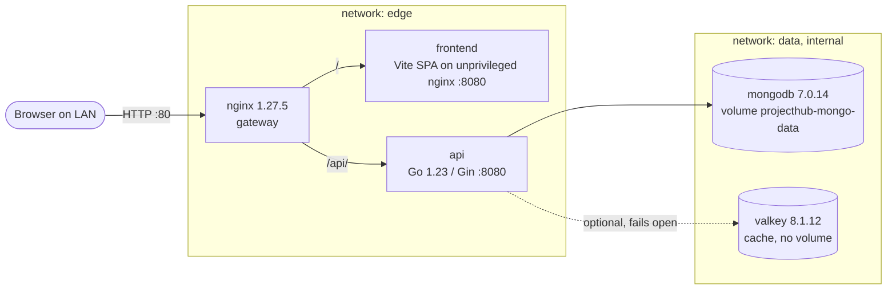
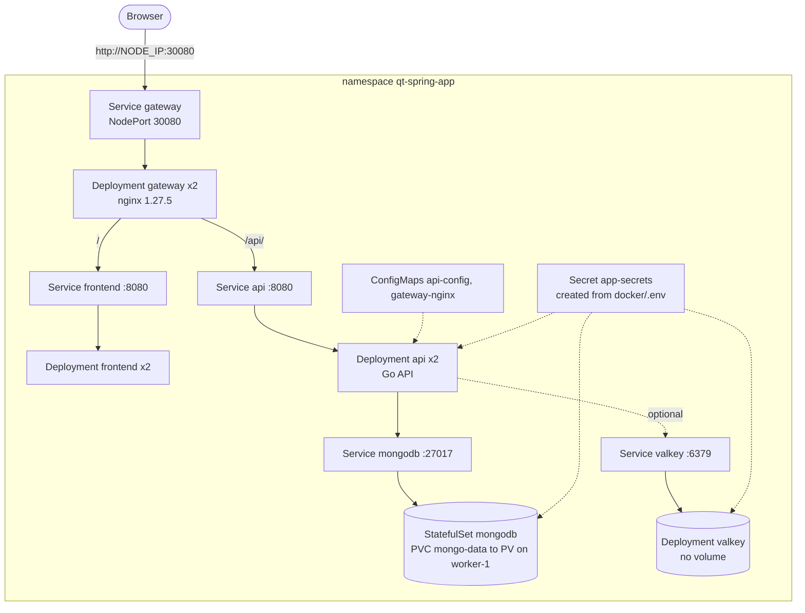

# ProjectHub on Proxmox: DevOps practical exam (candidate 5)

This repository deploys **ProjectHub** (the application in `app/`) three ways: Terraform VMs on Proxmox,
Docker Compose on one VM, and Kubernetes on a three-node kubeadm cluster.

> **The brief describes the stack wrongly.** It says "MyDiary", Next.js, Spring Boot, PostgreSQL and Redis.
> The code is **ProjectHub**: a Vite/React SPA, a Go 1.23 API (Gin), MongoDB 7 and Valkey 8 (optional cache).
> It has projects and tasks, not diary entries, and no search. The code is correct; this repo deploys the
> code as it is. Details: [docs/APP-ANALYSIS.md](docs/APP-ANALYSIS.md).

## Status

| Task | Status |
|---|---|
| Repo layout, secrets handling, pre-commit secret guard | Done |
| Task 1: Terraform VMs (`iac/`) | **Applied.** Four Kali VMs running, verified over SSH as `devops`. Evidence in `monitoring/task1-evidence.txt` |
| Task 3: Kubernetes cluster (`ansible/`) | **Built and verified**: kubeadm 1.32.5 control plane, Flannel, two workers, three Ready nodes. The devops password is set on all four VMs (password and key login verified). Full playbook reruns report `changed=0` |
| App analysis and move into `app/` | Done |
| Task 2: Docker images and Compose (`docker/`) | **Deployed on c3-docker-host** (http://192.168.160.11). Images pushed to Docker Hub as `angelsewase/projecthub-api:1.0.0` and `angelsewase/projecthub-frontend:1.0.0`. 34 of 34 functional checks pass on the VM |
| Task 3: Ansible Kubernetes cluster (`ansible/`) | Not started (needs the VMs) |
| Task 4: Kubernetes deployment (`k8s/`) | **Deployed on the exam cluster**. NodePort http://192.168.160.17:30080 (also .33 and .98). `verify.sh` 34 of 34. Resilience proof: clean runs from the laptop (302 requests, 0 failed) and the control plane (394, 0 failed). Control-plane instability caused by the Proxmox host, see the resilience section |
| Task 5: Monitoring (`monitoring/`) | Text evidence collected from all 4 VMs (`make collect-monitoring`), metrics-server installed. Screenshots: checklist in `monitoring/SCREENSHOTS.md`, **to be taken by hand** |

## Architecture

### Docker Compose deployment (c3-docker-host)



Only nginx publishes a host port (80). MongoDB and Valkey are on an internal network with no host ports.

### Kubernetes deployment (namespace `qt-spring-app`)



## Infrastructure creation (Task 1)

Prerequisites: Terraform 1.5 or later (tested with 1.17.2), `make`, the Proxmox token in `.private/secrets.env`,
and the SSH key in `.private/ssh/` (create it with `ssh-keygen -t ed25519 -N '' -f .private/ssh/id_ed25519`).

The brief says Ubuntu 24.04 for the VMs. The template is actually **Kali Linux** (verified through the Proxmox API,
see `docs/DECISIONS.md` D1).

```bash
make setup         # install the pre-commit secret guard
make tf-fmt        # formatting check
make tf-validate   # validate the configuration (no API calls)
make tf-init       # download the bpg/proxmox provider
make tf-plan       # write iac/tfplan
make tf-apply      # create the four VMs from template 9105
make tf-output     # print each VM's IP and SSH command
make inventory     # write ansible/inventory.ini from the IPs (gitignored)
```

### VM table

Created by `make tf-apply` on Proxmox node `server4`, pool `exam-c5`, from template 9105 (`kali-linux`, Kali GNU/Linux Rolling).

| VM name | Role | IP (DHCP) | VM ID | SSH user |
|---|---|---|---|---|
| c3-docker-host | Application host (Docker Compose) | 192.168.160.11 | 119 | `devops` |
| c3-k8s-master | Kubernetes control plane | 192.168.160.17 | 120 | `devops` |
| c3-k8s-worker-1 | Kubernetes worker (also holds the MongoDB volume) | 192.168.160.33 | 100 | `devops` |
| c3-k8s-worker-2 | Kubernetes worker | 192.168.160.98 | 121 | `devops` |

The IPs come from DHCP. Run `make tf-output` to confirm them, then `make inventory` to regenerate `ansible/inventory.ini`.

### VM login credentials

- SSH user: `devops`
- Password: **[PLACEHOLDER: add the VM password before submission]**
- SSH private key: **[PLACEHOLDER: add the key path or key to share with examiners before submission]**

Do not write real credentials in this file.

## Kubernetes cluster via Ansible (Task 3)

Run from the laptop. The playbook prepares every node, initialises the control plane, installs Flannel, joins the
workers, and checks for three Ready nodes.

```bash
make setup          # pre-commit secret guard (once)
make tf-output      # confirm the IPs
make inventory      # write ansible/inventory.ini from them (gitignored)
make ansible-lint   # production profile
make ansible-syntax # syntax check
make ansible-ping   # reachability
make ansible-run    # full playbook (sources .private/secrets.env for VM_PASSWORD)
```

The cluster-side checks are saved to `monitoring/task3-evidence.txt`. Running `make ansible-run` again is safe:
the second run reports `changed=0` on every host.

Cluster versions: Kubernetes v1.32.5 (kubeadm, kubelet, kubectl, packages held), containerd 2.1.9, Flannel v0.28.11
(vendored in `ansible/files/`), pod network `10.244.0.0/16`, OS Kali GNU/Linux Rolling with kernel 7.1.5.

Kubectl access: the control plane has `/home/devops/.kube/config` (copy of the admin kubeconfig, mode 0600).
From the laptop, copy it to `.private/kubeconfig` and point `KUBECONFIG` at it for `make k8s-deploy`.

## Docker Compose deployment (Task 2)

Images are built from source by multi-stage Dockerfiles and pushed to Docker Hub. Compose runs them.

```bash
make env                 # create docker/.env with generated secrets (chmod 600, gitignored)
make compose-config      # validate docker-compose.yml
make hadolint            # lint the Dockerfiles
make docker-build        # build both app images (tags from docker/.env)
make compose-up          # start the five services; nginx serves on port 80
make verify              # functional checks through http://localhost
make docker-push         # log in to Docker Hub and push api and frontend (needs real credentials)
```

**Deployed on c3-docker-host (192.168.160.11)** by the Ansible roles `docker_host` and `compose_app` (`make ansible-run`).
Access: http://192.168.160.11 (port 80). The VM pulls the Docker Hub images and never builds from source.
Compose project on the VM: `/opt/projecthub/docker`. Useful commands on the VM:

```bash
cd /opt/projecthub/docker
docker compose ps                  # service states
docker compose logs --tail=50 api  # API log tail (the Go API)
docker compose restart api         # restart one service
```

Publishing images (requires the Docker Hub token in `.private/secrets.env`): `make docker-push`.

Images and tags:

| Image | Tag | Base (pinned) |
|---|---|---|
| `angelsewase/projecthub-api` | `1.0.0` | `golang:1.23.12-alpine3.21` build, `alpine:3.21.10` runtime, uid 10001 |
| `angelsewase/projecthub-frontend` | `1.0.0` | `node:20.19.6-alpine3.21` build, `nginxinc/nginx-unprivileged:1.27.5-alpine` runtime, uid 101 |
| `nginx` | `1.27.5-alpine` | official |
| `mongo` | `7.0.14` | official |
| `valkey/valkey` | `8.1.12-alpine` | official |

Docker Hub namespace: `angelsewase` (public repositories).

## Kubernetes deployment (Task 4)

```bash
make env                                     # docker/.env (the Secret is built from it)
make k8s-render                              # render k8s/ to stdout (placeholders filled)
make k8s-validate                            # render, policy, nginx parity, strict schema, cluster dry-run
export KUBECONFIG=$PWD/.private/kubeconfig   # the exam cluster (copy from the master node)
kubectl label node c3-k8s-worker-1 projecthub/storage=mongo   # the MongoDB volume lives on this node
make k8s-deploy                              # create the Secret, apply everything, wait for rollout
make k8s-status                              # pods, services, volume claim
make k8s-verify K8S_URL=http://<node-ip>:30080
```

**Deployed on the exam cluster.** Access: http://192.168.160.17:30080 (control plane), http://192.168.160.33:30080 and
http://192.168.160.98:30080 (workers). The NodePort answers on every node.

Exam cluster run (kubeconfig copied from the control plane to `.private/kubeconfig`, mode 0600, gitignored):

```bash
export KUBECONFIG=$PWD/.private/kubeconfig
make k8s-validate                 # dry-runs against the cluster, plus offline checks
make k8s-deploy                   # secrets from docker/.env, then apply and wait for rollouts
make k8s-status                   # pods, services, PVC
make k8s-verify K8S_URL=http://192.168.160.17:30080
```

The MongoDB volume is on `c3-k8s-worker-1`. The node is labelled `projecthub/storage=mongo` by the Ansible role
`k8s_node_labels`, so no manual step is needed.

Validation without a cluster is limited: `kubectl apply --dry-run=client` needs a reachable API server in
kubectl 1.37 (for discovery). `k8s-validate` therefore runs offline checks first (kubeconform in strict mode
and a policy script that enforces requests, limits and probes) and the kubectl dry-runs when `KUBECONFIG`
points at a cluster. The local kind cluster used for testing ran all of it.

### Local test cluster (not the exam cluster)

Kubernetes v1.32.5 in kind (`projecthub-local`, one control plane, two workers), kubeconfig in
`.tmp/kind-kubeconfig`. Results: `make k8s-verify` against `http://127.0.0.1:30080` gave 34 of 34 passed.

## Functional test

`scripts/verify.sh <base-url>` checks, against any deployment:

- reachability: `/` returns 200 and `/projects/123` returns 200 (SPA fallback);
- health: `/api/health` reports `database` and `cache`;
- register two users, login (good and bad password), `/auth/me`;
- role rule: a member cannot create a project (403);
- a manager creates a project and a task, then lists them;
- isolation: a user who is not a member gets an empty project list and 404 on the project, its tasks and its tasks' status;
- sharing: adding the user to the project gives access; a second non-member still gets 404;
- admin sees all projects; unauthenticated requests get 401; the test project is deleted at the end.

Test accounts (created on the first start of an empty database, `SEED_ENABLED=true`):

| Role | Email | Password |
|---|---|---|
| admin | `admin@qt.rw` | `Admin@123` |
| manager | `manager@qt.rw` | `Manager@123` |
| member | `member@qt.rw` | `Member@123` |

The app has no diary entries and no search. The "create and search" requirement is covered by create and list.

## Kubernetes resilience proof

Run on the exam cluster. Full timestamped output: [monitoring/resilience-evidence.txt](monitoring/resilience-evidence.txt)
(laptop run, clean) and [monitoring/resilience-master-run.txt](monitoring/resilience-master-run.txt) (run on the control plane
from `/home/devops`, clean). Earlier attempts that were not clean are kept in [monitoring/resilience-attempts/](monitoring/resilience-attempts/).

```bash
KUBECONFIG=.private/kubeconfig scripts/resilience-demo.sh | tee monitoring/resilience-evidence.txt   # laptop
cd /home/devops && bash resilience-demo.sh                                                          # on the control plane
```

| Step | Key output (clean run, 11:23 to 11:25 UTC) | What it proves |
|---|---|---|
| a. Before | `api` 2/2, `valkey` 1/1, `mongodb-0` on `c3-k8s-worker-1`, health `{"status":"ok","database":"up","cache":"up"}` | Starting point: every pod is Ready and the cache is up |
| b. Scale API to 3 | `3 of 3 pods Ready for app.kubernetes.io/name=api`, 68 requests, 0 failed | New replicas are created and become Ready before they take traffic |
| c. Delete one API pod during the loop | The deleted pod goes `Terminating`. The replacement goes `Init:0/1`, then `Running 0/1`, then `1/1`. 134 requests in this window, **0 failed** | The Service routes around a pod that disappears, and the readiness gate protects the replacement |
| d. Valkey to 0 | `"cache":"down"` on all three samples. Login as `manager@qt.rw` OK, list projects `HTTP 200, 1 project(s)`. Valkey back: `"cache":"up"` | The cache is optional: losing it slows requests but does not break them |
| e. API back to 2 | `2 of 2 pods Ready`, 23 requests, 0 failed | The deployment returns to its normal size |
| Loop summary | `requests sent: 302   non-200 or failed: 0`, `kubectl errors seen: 0`, `RESULT: CLEAN` | Across all phases, no request failed and no kubectl call needed a retry |

The master run (copied to `/home/devops`) was also clean: `requests sent: 394`, 0 failed, 0 kubectl errors.

Notes: the request loop asks for `/api/health` every 0.2 s through the NodePort. Each request takes some time itself,
so the average gap was about 0.26 s. The `Completed` or `Terminating` status during scale-down is a pod shutting down
gracefully, not a crash.

### Verdict rules and control-plane stability

`resilience-demo.sh` does not claim success on its own. It prints `RESULT: CLEAN` only if all of these hold: no
kubectl call needed a retry, no phase failed, no request failed, and the final state is correct (API 2/2, Valkey 1/1,
cache up). It always restores Valkey to 1 and the API to 2 on exit, even after an error or Ctrl-C.

The control plane of this exam cluster is not fully stable. During testing (10:42 to 11:05 UTC) etcd on the control
plane repeatedly could not write to its disk in time, and the API server, controller-manager and scheduler were
affected: `kubectl` timeouts, two crash-looping control-plane components, and an API server that briefly refused
connections. The cause is on the Proxmox host, not in the cluster; the analysis and proposals are in
[docs/DECISIONS.md](docs/DECISIONS.md) (D-STOR-1 to D-STOR-4). One of the three runs that followed the fixes was not
clean: it logged two `/readyz` failures from etcd (the script waited and continued, and the verdict correctly said
`NOT CLEAN`). The two clean runs above came after the fixes.

### Why Valkey needs no persistent storage

Valkey holds only data the application can rebuild from MongoDB: dashboard figures and short-lived user lookups,
each with a TTL of one to two minutes. Losing it means the next request reads MongoDB, which is slower but
correct. So the cache runs with persistence turned off (`--save ''`, `--appendonly no`) and has no PersistentVolume.
Adding one would store data that is always disposable, and it would add a volume to recover in the case that
matters least. The database, which is the source of truth, has the PersistentVolume.

## Resilience and failure behaviour (tested locally)

| Scenario | Result |
|---|---|
| Stop Valkey | `/api/health` returns 200 with `"cache":"down"`; all 34 checks still pass |
| Stop MongoDB | `/api/health` returns 503 with `"database":"down"`; recovers when MongoDB returns |
| Restart the API (new IP) | nginx reaches it without a reload (resolver with runtime lookup) |

Redis-style cache: the cache holds only rebuildable data (dashboard figures and user lookups), so it has no
persistent volume. Without it the API reads MongoDB directly and works, only slower.

## Troubleshooting and logs

- Compose logs (on the VM): `cd /opt/projecthub/docker && docker compose logs -f --tail=50 api`. Locally: `make compose-logs SERVICE=api`.
- Kubernetes logs: `kubectl -n qt-spring-app logs deploy/api --tail=50`; `kubectl -n qt-spring-app logs statefulset/mongodb`.
- Health: `curl http://<host>/api/health`.
- Pods not ready: `kubectl -n qt-spring-app describe pod <name>` and `kubectl -n qt-spring-app get events --sort-by=.lastTimestamp`.
- nginx 502 or 504: check the upstream pod with `kubectl -n qt-spring-app get endpoints api`.

## Monitoring

Monitoring uses standard command-line tools on each VM, plus `kubectl top` (metrics-server) on the cluster. Everything
that is text is saved with UTC timestamps; the screenshots are taken by hand from a terminal and browser, with the
commands listed in [monitoring/SCREENSHOTS.md](monitoring/SCREENSHOTS.md).

### Text output (automated, read-only)

```bash
make collect-monitoring     # runs scripts/collect.sh on all 4 VMs; saves monitoring/<host>/collect-<UTC>.txt
```

What each file holds:

| Host | Sections |
|---|---|
| every VM | `top` (batch, one iteration), `ps` by CPU and memory, `df -h`, `free -h`, `vmstat 1 3` (virtual memory and disk I/O), `uptime` (load 1, 5, 15 min), `ss -tulpn`, addresses |
| c3-docker-host | `docker ps`, `docker stats --no-stream`, compose service health, API log (last 50 lines), Valkey memory, hits and misses, cached keys, health through NGINX |
| c3-k8s-master | `kubectl get nodes -o wide`, `kubectl get pods -A -o wide`, `kubectl top nodes`, `kubectl top pods -A`, app services and pods, health through the NodePort |

Other text evidence: [monitoring/final-verify.txt](monitoring/final-verify.txt) (verify.sh on both URLs),
[monitoring/resilience-evidence.txt](monitoring/resilience-evidence.txt) (resilience proof),
[monitoring/task1-evidence.txt](monitoring/task1-evidence.txt), [monitoring/task2-evidence.txt](monitoring/task2-evidence.txt),
[monitoring/task3-evidence.txt](monitoring/task3-evidence.txt), and [monitoring/task4-evidence.txt](monitoring/task4-evidence.txt).

### metrics-server

`kubectl top` needs metrics-server. It is installed by the Ansible role `k8s_metrics`: pinned to **v0.9.1** and vendored in
`ansible/files/metrics-server-v0.9.1.yaml`. kubeadm kubelets serve self-signed certificates, so the role adds
`--kubelet-insecure-tls` (idempotent `lineinfile`). The role waits until `kubectl top nodes` returns data for all three nodes.

### Health and logs

- Health: `GET /api/health` returns 200 with `{"status":"ok","database":"up","cache":"up|down"}` (503 when MongoDB is down).
  It is wired into the compose healthcheck, the Kubernetes readiness and liveness probes, and the functional test.
- Logs: on the docker host, `cd /opt/projecthub/docker && docker compose logs --tail=50 api`. On the cluster,
  `kubectl -n qt-spring-app logs deploy/api --tail=50`.
- Resources: every container has CPU and memory requests and limits (the Kubernetes policy check enforces this). Show
  them with `kubectl -n qt-spring-app describe pod <name>` or `kubectl top pods -n qt-spring-app`.

### Screenshots

Each image is referenced by its filename and embedded with a relative path. They render once you add them to `monitoring/`.

#### Per VM: top, df -h, free -h, uptime, ss -tulpn

**c3-docker-host** (192.168.160.11)


**c3-k8s-master** (192.168.160.17)


**c3-k8s-worker-1** (192.168.160.33)


**c3-k8s-worker-2** (192.168.160.98)


#### Docker host: containers, logs, cache, health


#### Control plane: nodes, pods, metrics, health


#### Resilience demo (run from /home/devops on the master)


#### The application in a browser

Docker Compose, http://192.168.160.11:


Kubernetes NodePort, http://192.168.160.17:30080:


## Troubleshooting: login returns 403

Symptom: the login page loads, but submitting the form returns HTTP 403 from the API. Cause (D-CORS-1): the API only
accepts browser origins that are listed in `CORS_ORIGINS` (or that match the request's Host). The NodePort origin includes
the port, so it has to be listed explicitly. The list is set in `k8s/10-config.yaml` and `docker/docker-compose.yml`.

Check: `curl -s -o /dev/null -w '%{http_code}\n' -X POST -H 'Origin: http://<node-ip>:30080' -H 'Content-Type: application/json' -d '{"email":"manager@qt.rw","password":"Manager@123"}' http://<node-ip>:30080/api/auth/login` must return 200.
To add a new address, add its exact origin to both lists and run `make k8s-deploy` (or `make ansible-run` for Compose).

## Repository layout

See [docs/STRUCTURE.md](docs/STRUCTURE.md) for the full tree. Decisions are in [docs/DECISIONS.md](docs/DECISIONS.md),
the running log is in [docs/WORKLOG.md](docs/WORKLOG.md), and operations steps are in [docs/RUNBOOK.md](docs/RUNBOOK.md) (later).

## Still to do before submission

- Take the screenshots listed in [monitoring/SCREENSHOTS.md](monitoring/SCREENSHOTS.md) (37 images, filenames fixed). The README already embeds them.
- Fill in the credential placeholders: the VM password (kept in `.private/secrets.env`, not in this file), the SSH key or key path you want examiners to use, and the Docker Hub account (`angelsewase`, already set).
- Commit `monitoring/` after the screenshots are added, and push the repository to the exam Git server.
